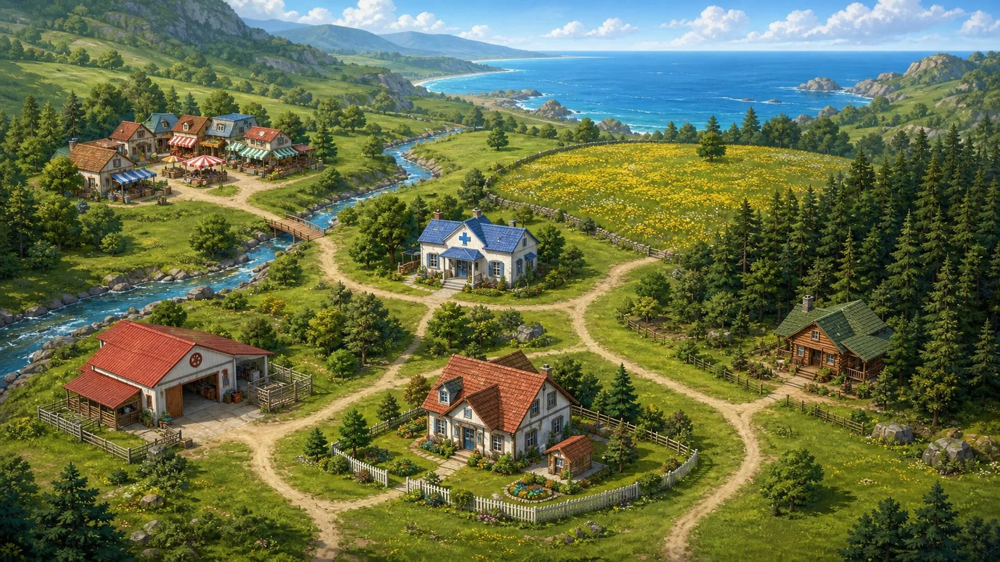
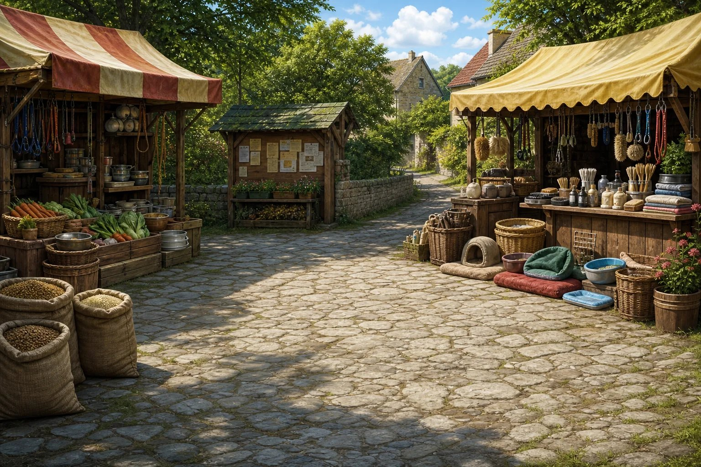
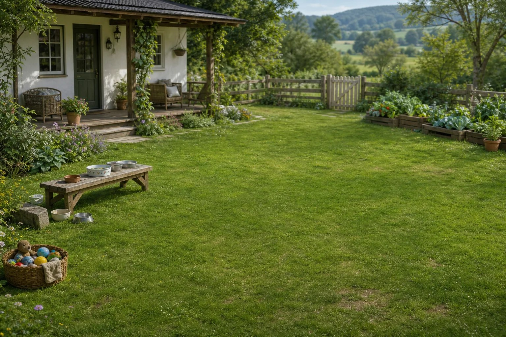
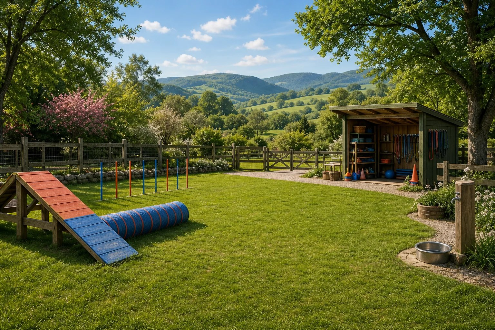

<p align="center">
  
</p>

<h1 align="center">山谷动物家园</h1>

<p align="center">一款山谷生活模拟与动物互动游戏</p>

## 简介

在九个地点之间活动，救助、领养动物，安排饮食、清洁、玩耍与睡眠，用经营所得扩建家园。

## 玩法

- **日循环**：查看时段、天气、地点事件与动物限定活动 → 选一名已入住且清醒的伙伴外出 → 完成地图事件或动物专属小游戏获得金币、口碑与资源 → 回家照料伙伴或布置家具 → 安排睡眠 → 次日归档并刷新世界。
- **动物专属玩法**：猫在湖畔钓鱼、兔的节奏拔萝卜、柯基/贵宾的力度投掷、狐狸的气味追踪、鹦鹉的低空召回等。
- **生活日程**：饮食、清洁、玩耍、家居互动与睡眠按动物隔离记录；事件与小游戏归属启动任务的动物。
- **自适应**：手机与桌面均保留完整视野。

## 画面

<p align="center">
  
  
</p>
<p align="center">
  
  
</p>
<p align="center">
  
</p>

## 技术栈

- 原生 HTML / CSS / JavaScript（`game.js` 为经典脚本，`vendor/gsap.min.js` 提供动效），无构建步骤。
- 运行时依赖仅 GSAP（已随包放在 `vendor/`）；测试使用 jsdom。

## 运行

在项目根目录启动静态服务器：

```bash
python3 -m http.server 4173
```

浏览器打开 http://localhost:4173/ 。

等价命令：`npm run dev` / `npm start`；测试：`npm test`。

## 目录结构

```
pets/
├── index.html        入口
├── game.js           主逻辑（动物、日程、事件、小游戏）
├── styles.css
├── vendor/           GSAP 运行时
├── assets/           动物、道具、房间、场景、音频、UI
├── scripts/          素材处理与发布工具
├── tests/            冒烟测试
├── docs/             设计与玩法文档、画面截图
└── DESIGN.md / PRODUCT.md / GAMEPLAY_SPEC.md  设计与玩法文档
```

## 说明

- 版权与许可：作者保留所有权利（未声明开源协议）。
